# Vizbox - 积木化搭建、灵活扩展的工业视觉方案

<p align="center">
  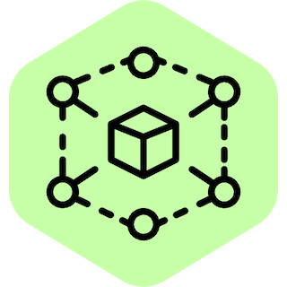
</p>

> **积木化搭建、灵活扩展的工业视觉方案**
>
> 按需拼装 · 按块扩展 · 换算法不换平台

## 产品定位与产品理念

### 一句话定位

Vizbox 把工业视觉拆成一组可独立拼装的积木块，让客户从最小可用的一套开始，随着摄像头、算法和业务规模的增长，按块加装、按块替换，而不是一次性建成一套难以调整的庞大系统。

平台面向园区、厂区、仓储、楼宇和公共设施，统一接入摄像头与视频通道，提供实时预览、AI 分析、规则告警、人脸管理、录像回放和可视化看板。

与"每路摄像头配一套算法盒子"或"绑定单一算法厂商"的传统方案不同，Vizbox 将视频接入、推理调度、算法执行和业务规则拆分为独立层次：

- **控制面**（CC）负责用户、权限、配置、授权、审计和服务健康。
- **数据面**（Gateway / DP / Recorder / SRS）负责拉流、抽帧、推理、叠框、录像和媒体分发。
- **算法面**通过标准化的本地 IPC 协议接入 Python / C++ 算法节点，算法可自研、可替换、可版本化发布。

一句话概括：**用一套平台管理所有摄像头，用可插拔的算法节点承载所有 AI 能力，按业务规模逐步扩容，而不是一次性超配。**

### 基础积木

| 积木块 | 组成 | 拼装方式 |
|---|---|---|
| 控制块 | CC、权限、配置、审计、授权 | 全局一块底板，统一编排其他积木 |
| 接入块 | Gateway、RTSP/RTMP/GB28181/ONVIF 接入 | 每个站点或网段部署一块，就近接入摄像头 |
| 算法块 | 模型版本、处理节点、Python/C++ 算法节点 | 按业务增加或替换，不改平台代码 |
| 算力块 | DP、Worker、CPU/GPU 节点 | 推理压力增大时加一块，按权重分配任务 |
| 媒体块 | SRS、ZLM、vz-sip、录制服务 | 按播放与国标需求选择，按读者规模扩展 |
| 存储块 | SQLite/PostgreSQL、文件系统/MinIO/RustFS | 小规模轻量起步，规模化按需替换 |

### 拼装原则

1. **按需拼装**：需要什么装什么，最小单机也能跑通"接入 → 分析 → 告警 → 录像 → 回放"闭环。
2. **按块扩展**：瓶颈在哪块就加哪块，控制块、数据库和消息总线不随摄像头数量线性复制。
3. **换块不推倒**：算法、模型、媒体和存储都可以单独替换，设备、区域、规则和看板配置保持不动。

## 积木化带来的核心价值

| 价值 | 说明 |
|---|---|
| 按块扩展 | Gateway、DP、Recorder、SRS 均可多实例注册；控制面保持单一入口，容量随数据面增加而增长 |
| 算法即插即用 | 新增算法只需交付模型和算法节点，按标准协议接入，无需修改平台代码 |
| 多通道建模 | 一台设备 = 一台摄像头 + 多路通道，预览流与 AI 流可独立选择 |
| 最小可用拼装 | 单机即可跑通"接入 → 抽帧 → 推理 → 告警 → 录像 → 回放"闭环 |
| 存量设备复用 | 支持 RTSP/RTSPS、RTMP、GB28181、ONVIF 和本地视频文件，保护既有摄像头投资 |
| 只为需要的积木付费 | SQLite / 文件系统起步，按规模演进到 PostgreSQL / 对象存储；授权按摄像头数量离线管理 |

## 总体架构：积木如何连接

平台采用控制面与数据面分离的积```mermaid

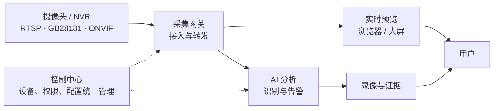

架构要点：

1. **控制与数据分离**：CC 不执行解码和推理，Gateway 不加载检测模型，算法节点不访问网络、数据库或对象存储。
2. **帧与消息分离**：Gateway 将抽样帧写入对象存储，NATS 只传 `frame_ref`、哈希、时间戳和路由信息。
3. **服务统一注册**：Gateway、DP、Recorder、SRS 以独立身份注册到 CC，上报心跳、负载、版本和配置版本。
4. **媒体与业务解耦**：SRS 负责 RTMP 接入、HTTP-FLV / WebRTC 播放；GB28181 由 vz-sip 信令与 ZLM 媒体承担。

从积木视角看：CC 是底板，Gateway/DP/SRS/Recorder 是功能块，模型与算法节点是插件块，数据库与对象存储是仓储块。底板只有一套，功能块可以按站点和压力增加，插件块可以独立升级。

## 横向扩展：加一块，而不是换一套

### 扩展路径

| 规模阶段 | 拼装形态 | 新增积木 | 扩展结果 |
|---|---|---|---|
| 试点 / 小规模 | 单机 | 最小一套：CC + SQLite + NATS + Gateway + DP + Recorder + SRS | 一条命令跑通闭环，零额外中间件 |
| 中型园区 | 控制、媒体、计算分机 | 增加 Gateway 接入新网段，增加 DP 分担推理，按需增加 SRS | 容量随压力增长，控制面不变 |
| 多站点 / 边缘 | 核心集中 + 边缘接入 | 边缘增加 Gateway 与本地缓存 | 就近取流，断网可按最近配置继续采集 |
| 大规模 | 多节点池 | PostgreSQL、NATS JetStream、对象存储、多计算节点 | 按摄像头规模与算力池扩展 |

### 扩展机制

- **统一注册与身份**：每个实例拥有不可复用的 `service_id` 和节点凭证，注册信息包含服务类型、版本、能力、监听地址和配置版本。
- **心跳与容量矩阵**：CC 展示在线、降级、离线、维护/排空状态，以及摄像头数、任务数、CPU/内存/GPU、队列、流量和错误计数。
- **配置快照**：CC 生成带版本和签名的配置快照；实例只在版本更高且校验通过时应用，失败保留旧版本。
- **按资源分配**：摄像头按网关分配，处理节点按 DP 分配，媒体流按网关/设备选择 SRS 节点，避免所有实例争抢同一资源。
- **无损下线**：节点下线前停止接收新任务、排空在途消息和流发布，再由 CC 更新状态。

扩展的关键不是"能启动第二个进程"，而是**新加的那块积木能被统一发现、配置、观测和下线**。Vizbox 把这部分收敛在 CC，运维不需要手工维护节点清单。

## 动态添加算法节点：算法也是可插拔积木

### 从模型到可执行节点


在积木模型里，模型是零件，处理节点是插件块，算法节点是真正跑起来的执行块。处理节点绑定一个模型版本和一组预处理、阈值、并发参数；DP 为每个处理节点启动 `worker_count` 个算法节点进程。模型或参数变化时，DP 按配置指纹决定复用还是重建进程，旧进程排空后退出。

### 算法节点的边界

算法节点只做三件事：**读取父进程已落地的本地帧 → 执行模型计算 → 通过本地 IPC 返回结果**。

- 不拉流、不访问对象存储、不连接 NATS/HTTP、不写数据库。
- 帧的获取、缓存、清理，任务的排队、超时、重试、结果聚合，告警判定和消息发布全部由 DP 父进程承担。
- 通信使用 `socketpair(AF_UNIX, SOCK_STREAM)` + NDJSON，单条消息上限 1 MiB，不经过网络。
- Python 与 C++ 使用同一协议、同一生命周期、同一结果契约，同一套一致性用例必须同时通过。

这种边界让算法团队只关注模型和推理，平台团队只关注调度和稳定性，双方通过协议解耦。

### 动态发布的完整过程

1. 在模型页登记新模型版本，写入权重、标签和校验和。
2. 在处理节点页创建节点，选择模型、设置置信度/IOU、并发数、权重和超时。
3. CC 生成新配置快照，DP 拉取后校验模型文件与运行时。
4. DP 启动新进程，节点返回 `node.ready` 描述符，校验通过后开始消费。
5. 旧版本进程进入排空，待在处理任务完成后退出；失败时按指数退避重启，不影响其他节点。

对人脸等"检测 + 特征提取"的两段式算法，处理节点可同时绑定主模型和辅助模型，节点在初始化阶段完成两段模型校验与预热。

### 为什么这对客户重要

- **不锁定算法厂商**：算法以节点为单位交付，替换算法不需要替换平台。
- **不影响在线业务**：新增或升级算法节点不需要重启 CC 或 Gateway。
- **可灰度、可回滚**：模型版本和节点配置均可回退，旧进程保留到新版本健康后再退出。
- **算力可运营**：节点权重、并发数和 DP 总 Worker 预算可调，按业务优先级分配算力。

## 性能设计：拼装之后仍然高效

积木化不是把组件简单堆在一起。平台在每块积木内部做优化，在块与块之间保持松耦合，从而在可扩展的同时降低单位视频路的计算、带宽和存储开销。Vizbox 不在文档中承诺未经基准测试的具体数值。

| 设计 | 作用积木 | 作用 |
|---|---|---|
| 同源共享解码 | Gateway | 同一 Gateway 上多任务共用一路源解码，避免同一摄像头被重复拉流、重复解码 |
| 同帧同模型去重 | Gateway + DP | 同一 `frame_seq + 模型版本 + 预处理` 只推理一次，结果按任务分发 |
| 抽帧与预览解耦 | Gateway | 预览帧率、AI 抽帧频率、告警频率相互独立，不为 AI 牺牲预览流畅度 |
| 元数据与帧分离 | Gateway + NATS + DP | NATS 只传小消息，帧走对象存储，避免大载荷造成总线积压 |
| 有界等待 + 最近框 | Gateway | AI 叠框不被单个慢模型无限阻塞；超时后按策略输出原帧或最近检测框 |
| stream copy 录像 | Recorder | 录制直接复制 H.264 流并按 30 秒分段，不做转码，CPU 与存储开销可控 |
| 空闲回收 | ZLM 预览链路 | 预览读者归零 30 秒后释放会话，避免无人观看时长期占用媒体资源 |
| 背压与死信 | NATS + DP | 队列深度、消息年龄、重试次数、ack deadline 均有上限，过期任务进入可观测状态 |
| 资源与链路指标 | 全链路 | 端到端延迟、抽帧 FPS、推理耗时、队列积压、迟到率、丢帧率均可观测 |

这些设计共同决定了容量模型：**CC、数据库、NATS 的进程数不随摄像头数量线性增长；随路数增长的是 Gateway 解码/编码、DP Worker、对象存储和 SRS 带宽。** 扩容时加的是缺的那块，不是整套复制。

## 设备逻辑概念：区域、设备、通道积木

Vizbox 将物理世界抽象为三层：区域表达"在哪里"，设备表达"哪台机器"，通道表达"哪路视频"。三层可以独立调整：区域随组织变化，设备随点位迁移，通道随设备能力增减，不需要重建上层分析任务。

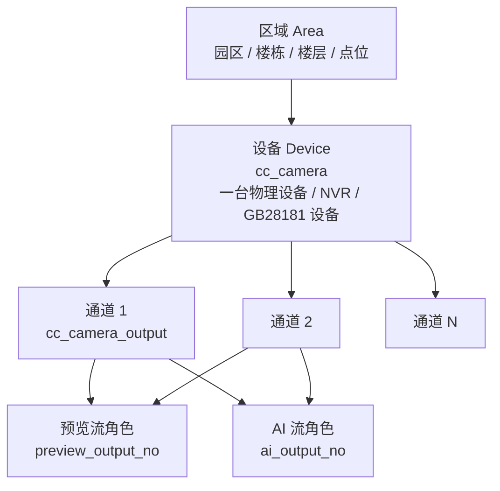

| 概念 | 对应实体 | 说明 |
|---|---|---|
| 区域 | `cc_area` | 物理位置树，支持任意层级承载设备；有子区域或设备时禁止删除 |
| 设备 | `cc_camera` | 一台摄像头、NVR 或 GB28181 设备；保存设备编码、预览流和 AI 流选择 |
| 通道 | `cc_camera_output` | 设备下的一路视频；保存来源类型、流地址、GB28181 通道编码和流级状态 |
| 预览流 | `preview_output_no` | 详情页、看板使用的通道 |
| AI 流 | `ai_output_no` | 网关解码分析的通道，录制跟随该通道 |

关键规则：

1. **一台设备 = 一台摄像头 + 多通道视频流**。GB28181 目录中的 N 个通道落成 1 台摄像头 + N 路流，不再拆成 N 台摄像头。
2. **预览流与 AI 流可以相同，也可以不同**，但必须指向本设备下的通道，不能为空或指向其他设备。
3. **同流场景**预览与 AI 都走 SRS；**异流场景**预览走 ZLM 直连 HTTP-FLV，AI 仍走网关 → SRS。
4. **GB28181 目录同步**按通道编码增量更新；缺失通道执行软删除，若正被用作预览流或 AI 流则返回冲突并禁止删除。
5. **GB28181 异通道预览**由 CC 通过 vz-sip 发起 INVITE，只释放预览会话，不影响 AI 通道。

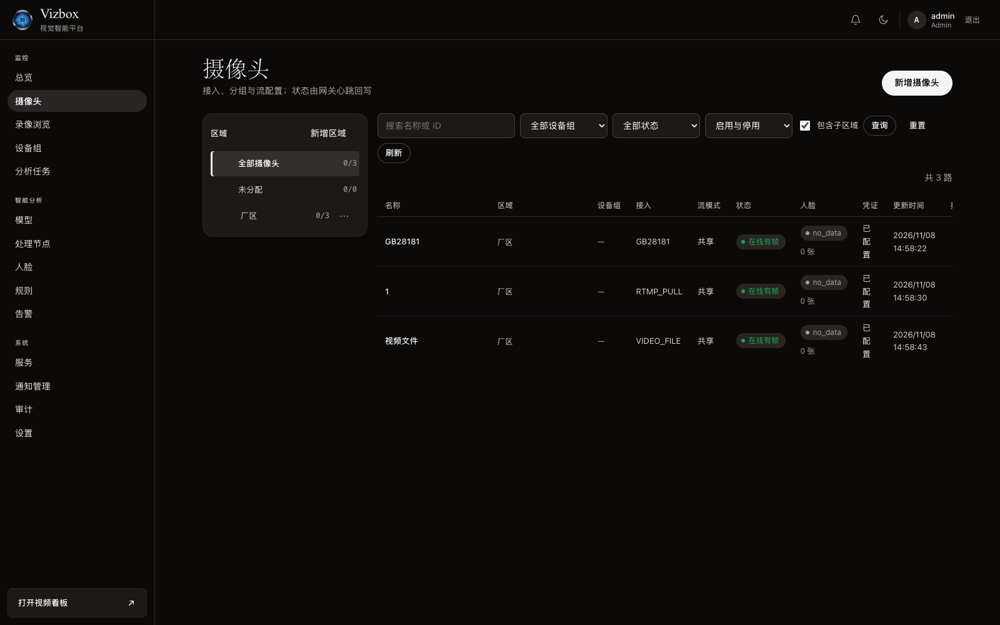

*摄像头列表：区域树支持任意层级与子区域计数，设备行展示接入类型、流模式、在线状态和人脸样本情况。*

## 部署拓扑：同一套积木，按规模拼装

### 轻量单机

适合试点、单站点和小规模项目：一台服务器或边缘一体机即可完成接入、分析、录像和播放。这是最小拼装形态。

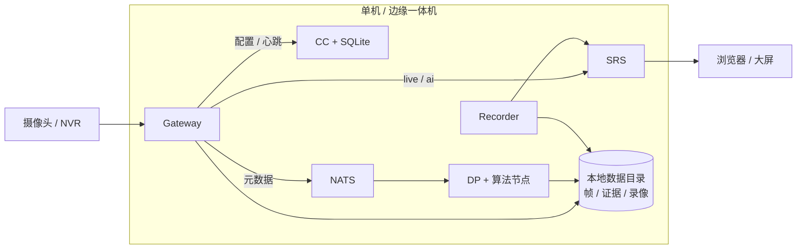

- 依赖少：SQLite、本地文件系统、单 NATS、单 SRS。
- 可离线：前端资源、模型和播放器随包交付，不依赖公网。
- 可演进：后续切换到 PostgreSQL、对象存储和多计算节点时，不需要更换平台。

### 标准私有化 / 多节点

适合中型园区、工厂和多站点：按角色拆分主机，按压力增加实例。同一套镜像和配置契约，差异只在拼装方式与容量。

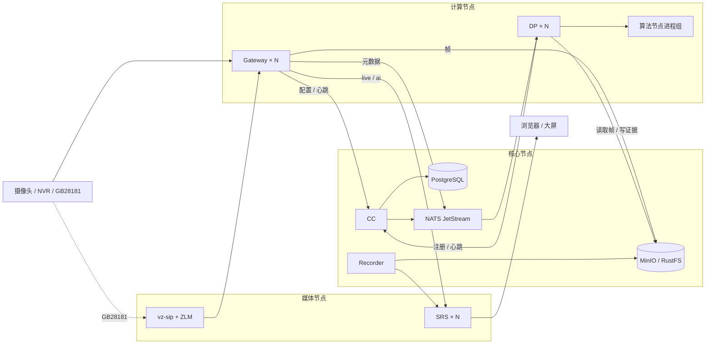

| 角色 | 组件 | 扩展信号 |
|---|---|---|
| 核心 | CC、PostgreSQL、NATS、对象存储 | 请求延迟、队列积压、存储水位 |
| 媒体 | SRS、vz-sip、ZLM | 发布者/读者数、带宽、端口与点播成功率 |
| 计算 | Gateway、DP、算法节点 | 摄像头数、解码/抽帧 FPS、推理耗时、CPU/GPU |

网络边界遵循"管理面不暴露、摄像头只由网关访问、播放经 CC 鉴权"的原则；数据库、NATS、对象存储和 DP 管理端口只在内部网络可达。

## 成本优势：只买需要的积木

积木化的经济性来自三件事：不提前买、不重复买、不为换块付迁移成本。

### 成本结构对比

| 成本维度 | 常见做法 | Vizbox 做法 | 带来的结果 |
|---|---|---|---|
| 初始投入 | 按最大路数一次性采购服务器和算法盒子 | 单机起步，按实际接入规模扩容 | 首期投入更低，试错成本可控 |
| 摄像头 | 绑定特定品牌或算法厂商 | 复用 RTSP/ONVIF/GB28181/NVR 存量设备 | 保护既有投资，减少替换 |
| 算力 | 一路摄像头一个推理进程或一台盒子 | 同源共享解码、同帧去重、加权 Worker 池 | 算力按任务和优先级分配，减少空转 |
| 算法 | 每接一个算法就改一次平台 | 标准算法节点协议，模型与节点独立发布 | 接入周期短，可替换、可回滚 |
| 录像 | 转码后存储，CPU 与容量双高 | stream copy 按 30 秒分段，源画质直存 | 降低编码开销和存储放大 |
| 存储 | 一开始就上分布式存储 | 文件系统起步，按规模切换 MinIO/RustFS | 小规模不浪费，大规模可扩展 |
| 扩容 | 整机替换或整套复制 | 只增加 Gateway / DP / SRS 实例 | 扩容粒度细，避免过度采购 |
| 运维 | 多套工具、手工维护节点清单 | 单一控制台、健康矩阵、配置快照、审计 | 降低人力与故障定位成本 |
| 授权 | 云端订阅或按调用计费 | 按摄像头数量离线授权，本地导入 | 预算可预期，适合内网与离线环境 |

### 总体拥有成本（TCO）逻辑

Vizbox 的成本优势不是单一组件的低价，而是**结构性减少重复投入**：

1. **视频只解一次、只推一次**：共享解码和同帧去重减少重复计算；已是 RTMP 源的摄像头不重复转推。
2. **算力只为实际任务付费**：抽帧频率、Worker 数量、节点权重都可配置，不需要为峰值一次性配满。
3. **录像不转码**：H.264 源流直接分段落盘，录制成本主要是磁盘而不是 CPU。
4. **存储按阶段选型**：小规模用本地文件系统，规模化再引入 MinIO/RustFS，避免早期过度设计。
5. **算法不被绑定**：客户可以引入自研模型、第三方算法或 OpenVINO/ONNX 生态模型，通过节点协议接入。
6. **扩容不换平台**：从一台到多台，CC、配置、权限、看板和审计保持不变，减少迁移和培训成本。
7. **按块升级**：数据库、对象存储、媒体节点可以独立替换，不必整套推倒重来。

## 功能积木地图

下表每一项都是可独立启用的能力积木，可以按项目阶段逐步打开。

| 积木 | 关键能力 |
|---|---|
| 接入块 | RTSP/RTSPS、RTMP 拉流/推流、GB28181、ONVIF、本地视频文件；连接测试、断线重连、流级状态 |
| 通道块 | 区域树、设备与通道、预览流/AI 流选择、GB28181 目录同步、单设备最多 64 路通道 |
| 预览块 | HTTP-FLV 播放、原始流/AI 流切换、1/4/9 分屏看板、短时播放令牌、空闲回收 |
| 算法块 | 模型版本管理、处理节点、Python/C++ 算法节点、实时/抓拍/巡检/人脸任务、主模型 + 辅助模型 |
| 规则块 | 规则编辑与发布、区域命中、告警合并/抑制、确认/静默/恢复、证据留存 |
| 人脸块 | 人脸检测、特征提取、人员登记、陌生人聚类、簇合并、时间线与代表图 |
| 录像块 | 文件系统/MinIO/RustFS 后端、30 秒分段、连续/仅事件策略、按时间与告警检索、回放与删除 |
| 通知块 | 站内、Webhook、邮件渠道，发送历史与失败重试 |
| 展示块 | 管理总览、视频看板、多页/主题/轮播（按版本规划）、只读看板入口 |
| 运维块 | 服务注册、心跳、健康矩阵、配置快照、日志与指标、审计日志、离线授权 |

## 界面一览

以下界面由同一套积木拼装出的本地实例直接截取，展示控制块与各功能块的协作结果。

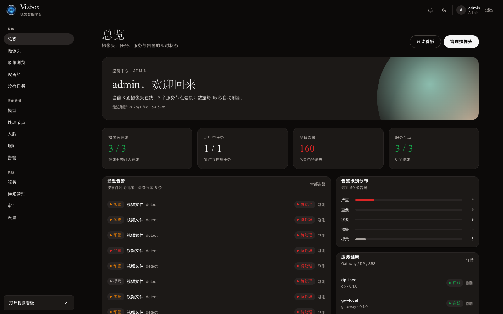

*总览：摄像头在线数、运行任务、今日告警和服务健康一屏掌握，告警按级别分布展示。*

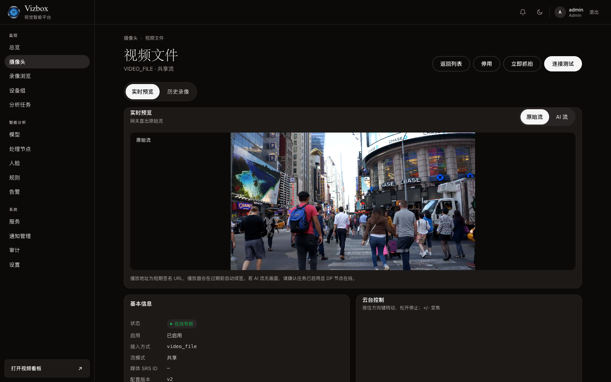

*摄像头详情：实时预览支持原始流/AI 流切换，右侧提供云台控制，底部展示基本信息和流状态。*

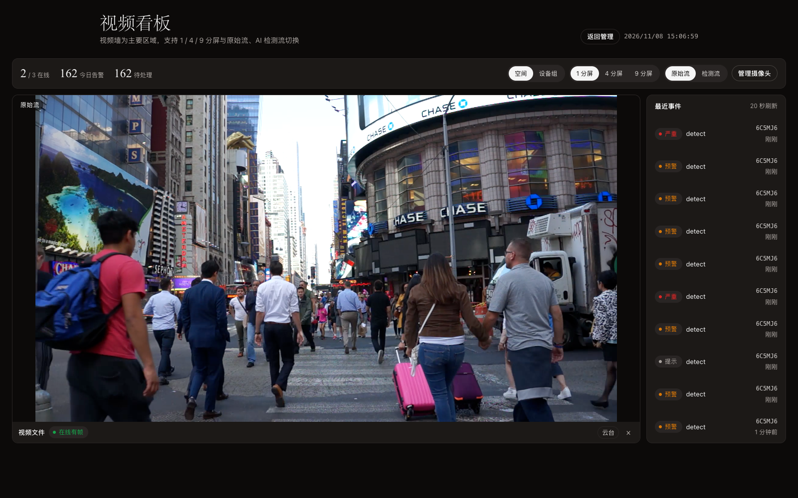

*视频看板：视频墙为主区域，支持 1/4/9 分屏、原始流/检测流切换，右侧实时事件流。*

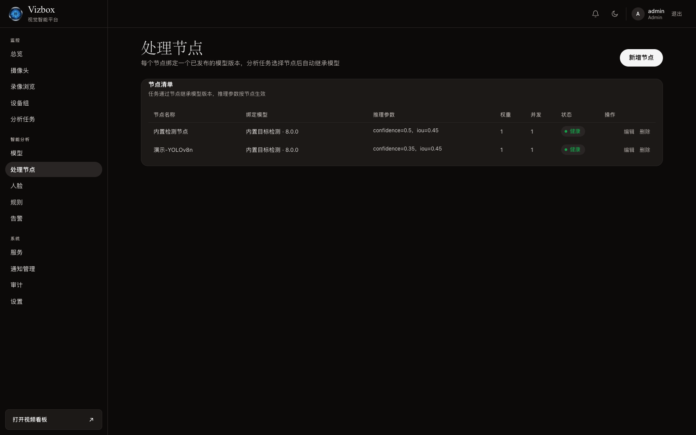

*处理节点：每个节点绑定一个已发布模型版本，可配置推理参数、权重、并发和启停状态。*

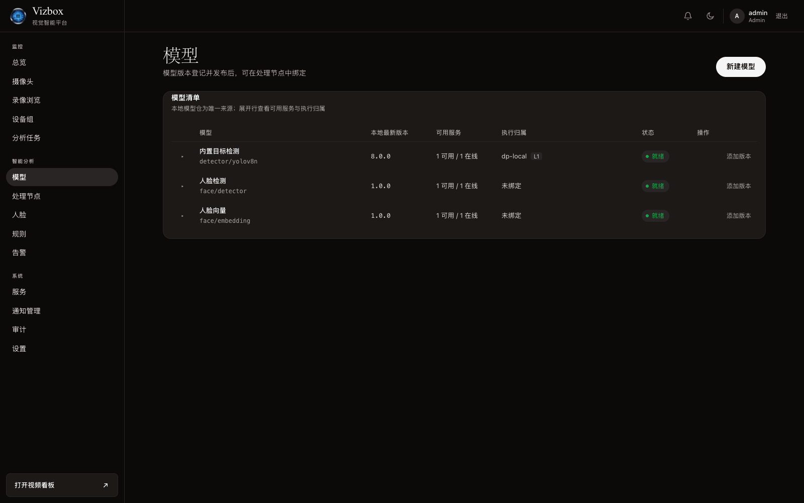

*模型：模型版本登记、可用服务、执行归属和状态一目了然，支持添加新版本。*

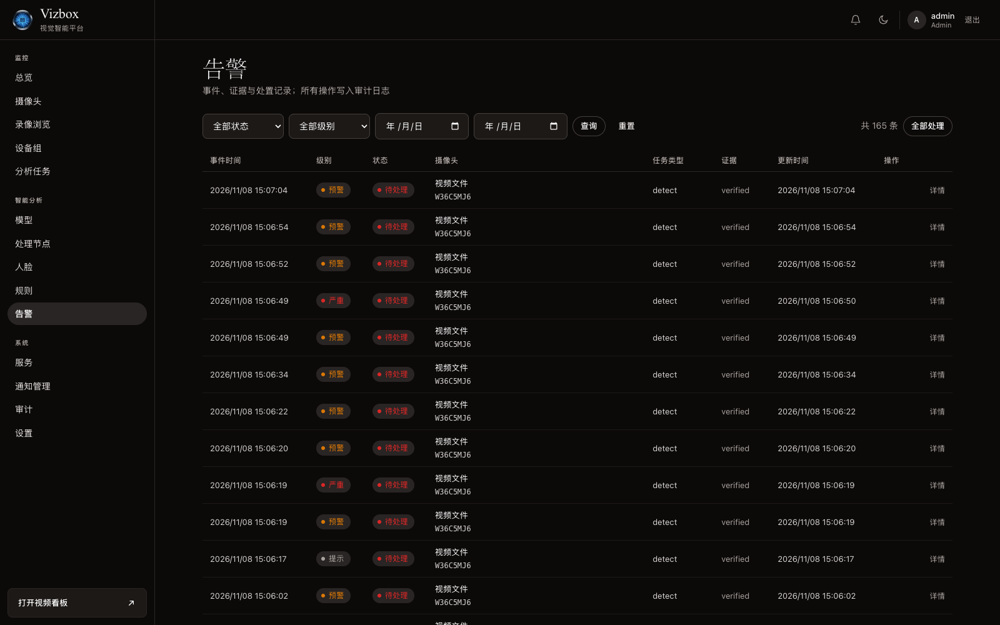

*告警中心：按状态、级别、时间和摄像头检索，展示证据状态与处理入口。*

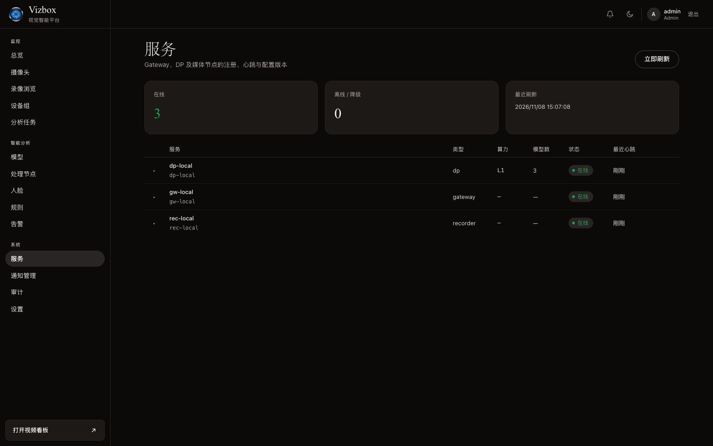

*服务：Gateway、DP、Recorder 等实例的注册、心跳、算力和模型数统一展示。*

## 适用场景与能力边界

### 典型场景

- **园区 / 厂区**：多区域摄像头统一接入，按区域树管理，重点区域运行目标检测与人脸任务。
- **仓储 / 物流**：多通道 NVR 接入，预览与 AI 分流，事件录像与回放取证。
- **楼宇 / 公共设施**：GB28181 设备接入，PTZ 控制，告警通知与可视化看板。
- **边缘站点**：单机或边缘一体机部署，断网时按最近配置继续采集，恢复后补传。

无论哪种场景，落地方式都是先拼出最小闭环，再按区域、算力或算法逐步加块，不需要为尚未发生的规模提前付费。

### 能力边界

- 首期不提供模型训练、数据标注、SAM/LLM/VLM 后处理。
- 高可用需要按标准部署规划数据库、NATS、对象存储和媒体节点，单机形态不承诺多副本。
- SRS、ZLM、NATS 作为外部依赖交付，平台负责注册、配置、健康与路由，不修改其内核。
- 具体性能指标应以目标硬件、摄像头分辨率、抽帧率和模型耗时为输入进行压测。

---

**Vizbox：积木化搭建、灵活扩展的工业视觉方案。从一块开始，随业务生长。**
